# Suha AI Tutor

Suha AI Tutor is an Electron desktop learning application for Ethiopian students in
Grades 7–12. It combines bundled curriculum lessons and question banks with a PDF
textbook reader, quizzes, national-exam practice, notes, progress tracking, and an
optional AI tutor.

The seeded lessons, seeded questions, notes, and progress features work locally. AI
features can use Ollama or LM Studio on the same computer, or Groq as an optional
online provider. Textbook-grounded AI answers require a PDF to be indexed first.

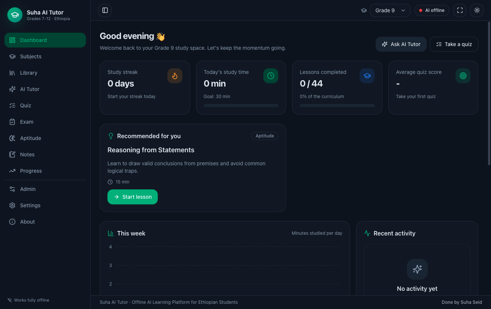

## Features

- **Grade-based curriculum:** switch between Grades 7–12. Grades 7–8 include
  English, Mathematics, and General Science; Grades 9–12 include English,
  Mathematics, Physics, Chemistry, and Biology.
- **Offline lessons:** bundled chapter and lesson content includes structured
  explanations, worked examples, visualizations, practice, summaries, glossaries,
  and flashcards where available.
- **PDF textbook library and reader:** import local PDFs, browse a table of contents,
  search pages, zoom or fit to width, use reader dark mode, add bookmarks and notes,
  draw pen/highlighter annotations, and resume at the last-read page.
- **Optional AI tutor:** use Ollama or LM Studio locally, or Groq online. The tutor
  supports grade/subject context, general chat, lesson help, and textbook-grounded
  chat through Retrieval-Augmented Generation (RAG).
- **Quizzes:** choose grade, subject, difficulty, question count, and Practice,
  Revision, Random, Adaptive, or Mock Exam mode. Use the bundled question bank or
  generate questions when an AI provider is available.
- **National-exam practice:** create timed 20-, 40-, or 60-question exams from the
  seeded bank or AI, or use an imported PDF paper with an answer key.
- **Aptitude practice:** logical, numerical, pattern, spatial, verbal, and critical
  thinking categories use seeded questions when available and can fall back to AI
  generation.
- **Notes and search:** create color-coded notes, search notes, and export them to
  Markdown. Global search covers lessons, books, notes, questions, glossary entries,
  and bookmarks.
- **Progress tracking:** study time, completed lessons, quiz history, average scores,
  topic mastery, streaks, achievements, and readiness trends are stored locally in
  SQLite.
- **Administration:** review RAG indexing status, generate question-bank content with
  AI, export content packs, export or back up the database, restore a backup, and
  restore the seeded curriculum.
- **Appearance and learning settings:** light, dark, or system theme; accent color;
  font scaling; reduced motion; English or Amharic selection; current grade; daily
  study goal; and RAG controls.

## Requirements

- Node.js 20 or newer
- npm
- Windows, macOS, or Linux
- Optional for AI features: Ollama, LM Studio, or a Groq API key

No AI server is required to read bundled lessons, take seeded quizzes and exams,
write notes, or track progress.

## Installation and development

```bash
git clone https://github.com/seidmengistu/Suha-Ai-Tutor-For-Students.git
cd Suha-Ai-Tutor-For-Students
npm install
npm run dev
```

`npm install` also rebuilds the native `better-sqlite3` dependency for Electron.
The first launch creates the local SQLite database and loads the bundled curriculum
and question banks.

To build the application and run the production preview:

```bash
npm run build
npm start
```

## Optional local AI setup

The default provider is Ollama.

```bash
ollama serve
ollama pull qwen3:8b
ollama pull nomic-embed-text
```

Then open **Settings → Local AI**, select **Ollama**, confirm the default URL
`http://localhost:11434`, and use **Test connection**.

For LM Studio, load a chat model, start its local server, select **LM Studio** in the
app, and confirm the default URL `http://localhost:1234`. Groq is also available, but
it is an online provider and sends AI requests to Groq using the API key configured
in Settings.

`nomic-embed-text` is the default Ollama embedding model used when indexing a
textbook for RAG.

## Adding textbooks

Textbook PDFs are not committed to this repository. Add them in either of these
ways:

1. Open **Library → Import textbook**, choose the grade and subject, and select a PDF.
2. Use the optional manifest downloader (requires internet access and depends on the
   listed source being available):

   ```bash
   npm run fetch:books
   npm run fetch:books -- --grade 9
   npm run fetch:books -- --selftest
   ```

Downloaded files are placed under `books/grade-<grade>/<subject>/` and registered on
the next launch. After opening a textbook, choose **Index for AI** to make it
available to textbook-grounded chat. Indexing requires the configured embedding
model to be running.

## Usage

1. Select the active grade from the top bar.
2. Open **Subjects** to browse lessons, books, and practice for a subject.
3. Use **Library** to import and read PDFs. Reader progress, bookmarks, annotations,
   and page-linked notes are saved locally.
4. Use **Quiz**, **Exam**, or **Aptitude** for practice. Results update the Progress
   page and dashboard.
5. Start Ollama or LM Studio before using local AI features. For textbook-grounded
   answers, index the relevant PDF and keep **Textbook grounding (RAG)** enabled in
   Settings.
6. Use **Admin → Database** to export or back up local data before moving to another
   computer or resetting the curriculum.

## Packaging

Build on the target operating system for the most reliable package:

```bash
npm run build:win    # Windows NSIS installer
npm run build:mac    # macOS DMG (arm64 and x64)
npm run build:linux  # Linux AppImage
npm run build:unpack # unpacked application for the current OS
```

Artifacts are written to `release/`. The Windows installer name is
`Suha AI Tutor-Setup-<version>.exe`.

## Screenshots

These screenshots cover every route-level screen in the desktop application. The
subject, lesson, and reader images show representative parameterized pages. They were
captured from a clean Grade 9 profile in the dark theme; the reader image uses a
local textbook PDF that is not included in the repository.

| Dashboard | Subjects |
|---|---|
|  | 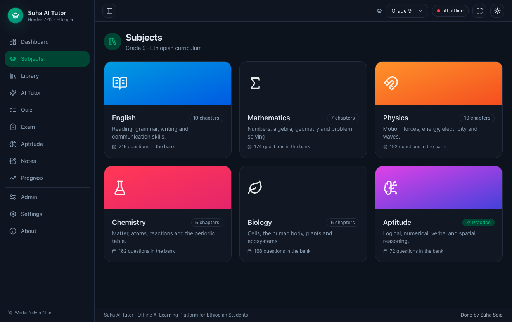 |

| Subject detail | Lesson |
|---|---|
| 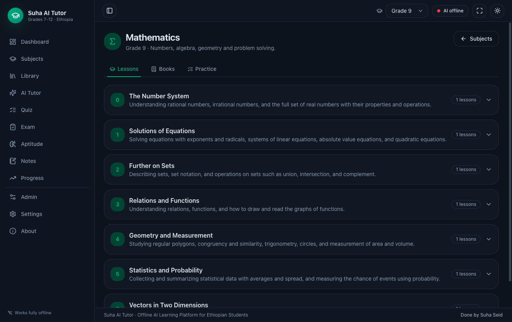 | 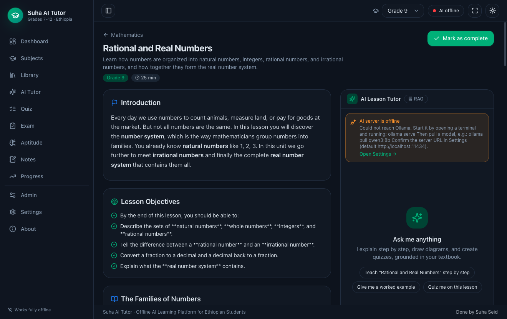 |

| Library | Textbook reader |
|---|---|
| 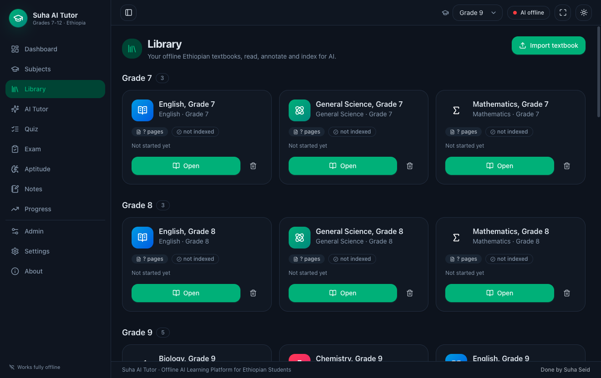 | 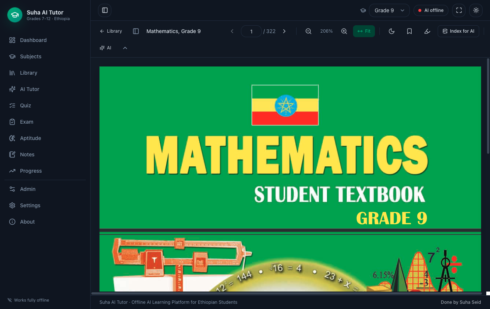 |

| AI Tutor | Quiz |
|---|---|
| 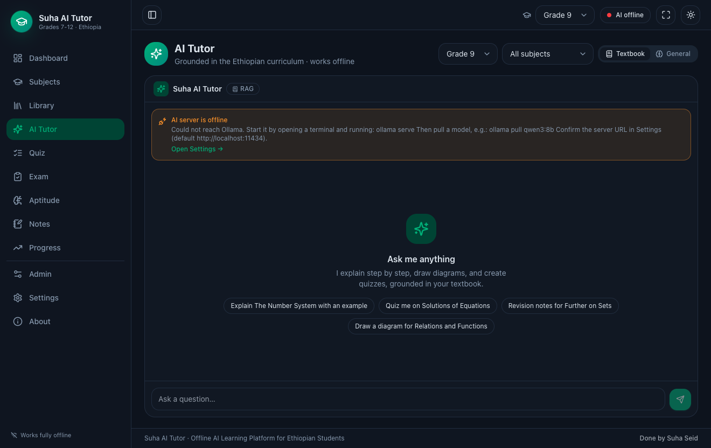 | 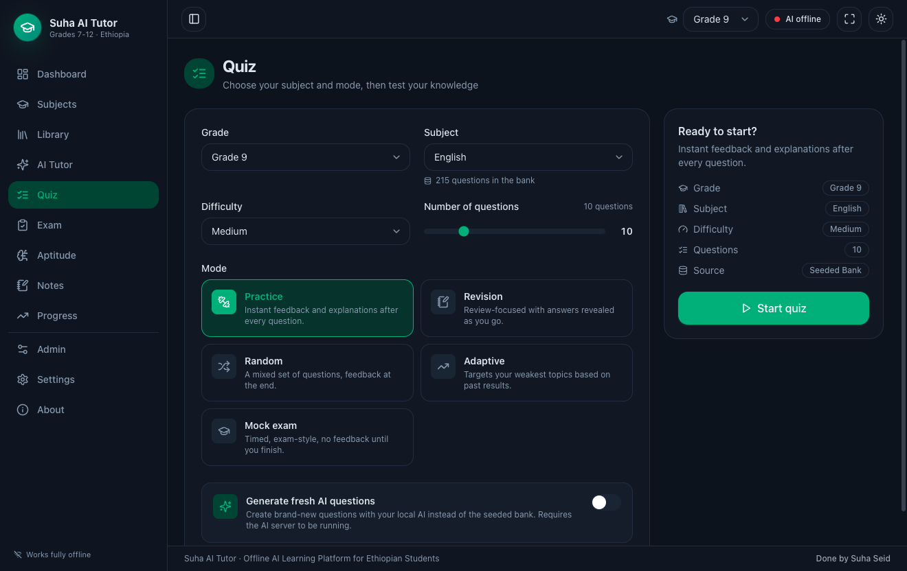 |

| National Exam | Aptitude |
|---|---|
| 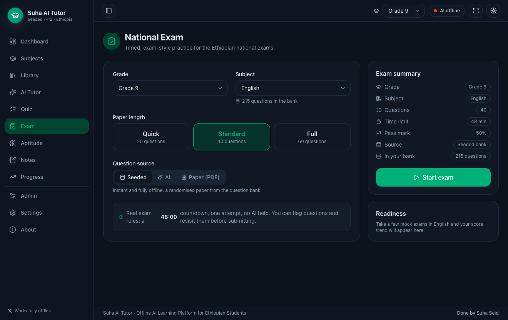 | 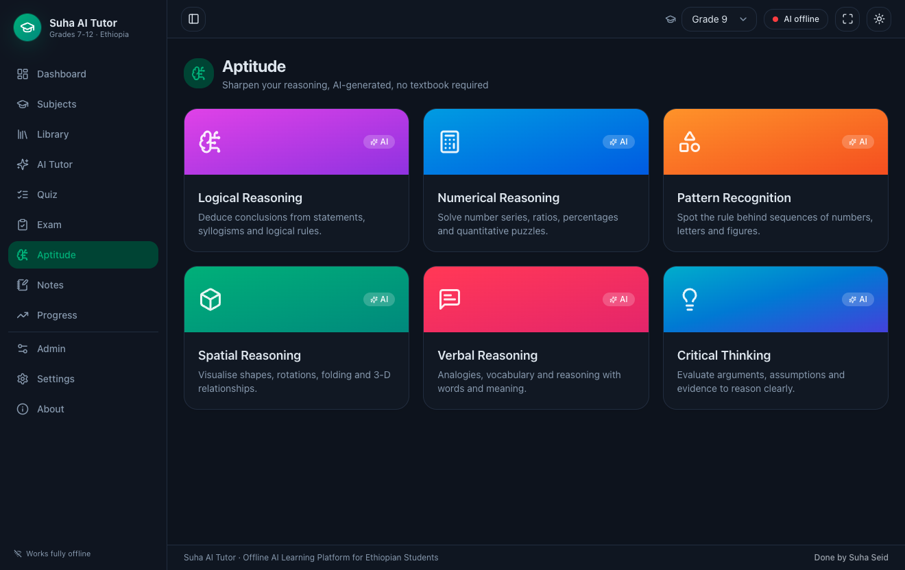 |

| Notes | Progress |
|---|---|
| 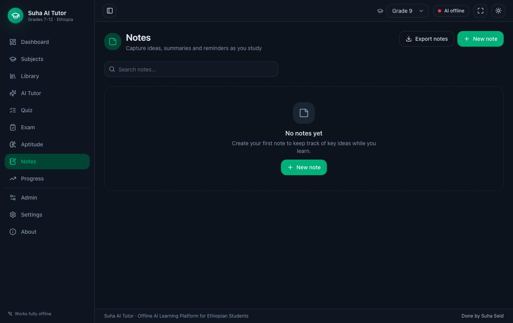 | 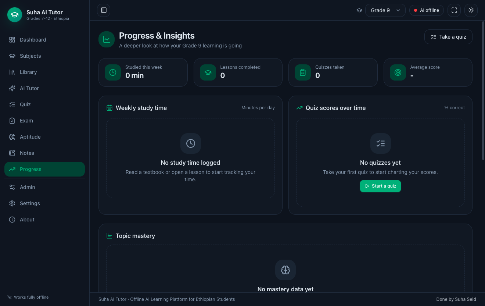 |

| Search | Admin |
|---|---|
| 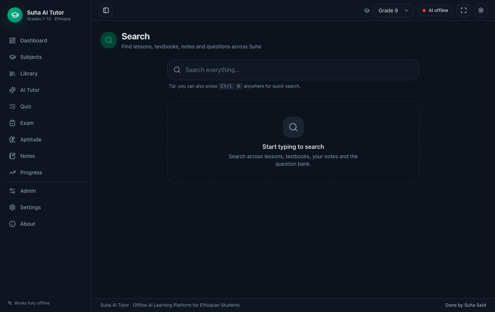 | 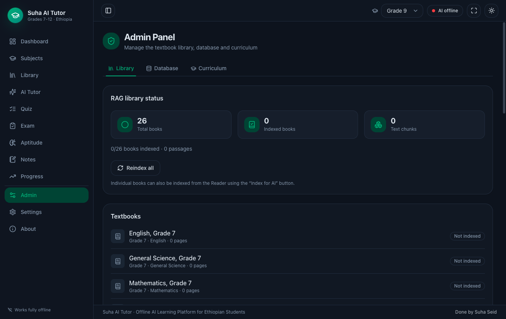 |

| Settings | About |
|---|---|
| 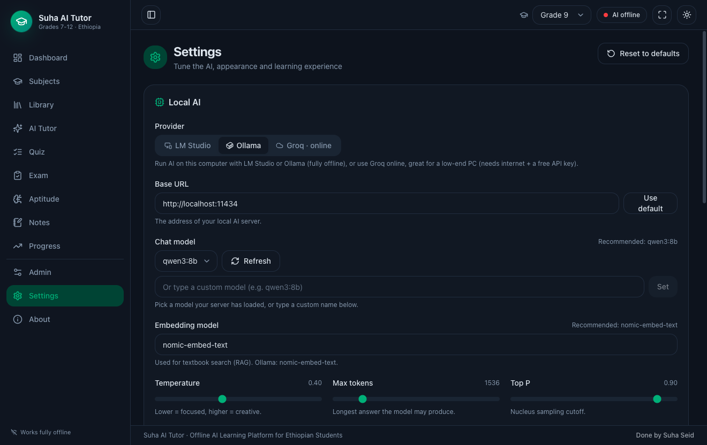 | 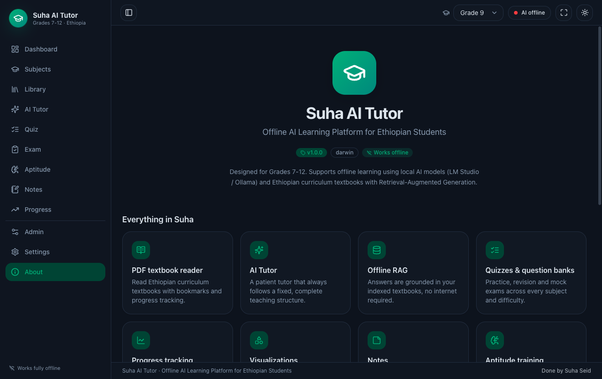 |

## Project structure

```text
src/
├── main/       Electron main process, SQLite, AI, RAG, books, and IPC services
├── preload/    Typed context bridge exposed to the renderer
├── renderer/   React pages, components, state, and styles
└── shared/     Shared types, curriculum constants, and default settings

resources/seed/ Bundled lessons and question banks
books/          Optional local textbook PDFs (PDF files are gitignored)
paper-exams/    Optional imported paper-exam content (PDF files are gitignored)
scripts/        Content download, icon, and data-flow utilities
docs/           User/developer guides and screenshots
```

The app is built with Electron, React, TypeScript, Tailwind CSS, Zustand, React
Query, SQLite, PDF.js, Recharts, Framer Motion, and electron-vite.

## Privacy and connectivity

App data is stored locally. Ollama and LM Studio keep AI requests on the local
computer. Groq is an online option and requires internet access. Downloading
textbooks also requires internet access; importing an existing local PDF does not.

MIT © 2026 Suha Seid
